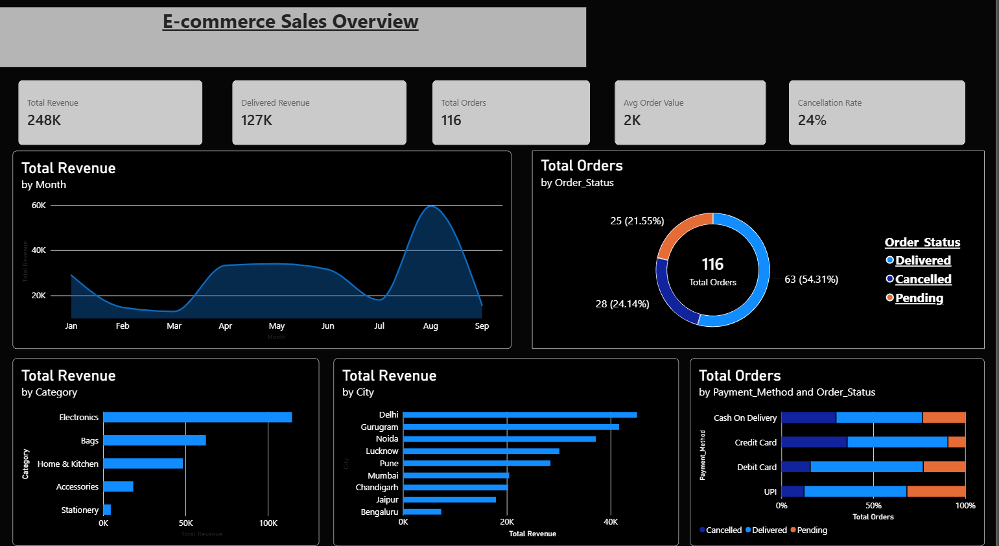

SWYNEX : E-commerce Sales Dashboard (Power BI)

An interactive Power BI dashboard built on 116 e-commerce orders (January to September 2026). It follows an exploratory data analysis done in Python and turns the main findings into KPIs, charts and filters.

**Prepared as part of an assignment for Swynex.**



## Objective
Give a quick, clear view of sales performance: how much revenue the business makes, when and where it comes from, and how many orders are lost to cancellations.

## Dataset
| Item | Detail |
|---|---|
| Rows / columns | 116 orders, 14 columns |
| Period | 1 Jan 2026 to 25 Sep 2026 |
| Customers / cities | 12 customers, 9 cities |
| Products / categories | 10 products, 5 categories |
| Payment methods | 4 |
| Order status | Delivered, Pending, Cancelled |

Columns: Order_ID, Customer_ID, Customer_Name, City, Order_Date, Product_ID, Product_Name, Category, Quantity, Unit_Price, Discount, Payment_Method, Order_Status, Total_Amount.

## Data cleaning
Three rows had invalid values. Each was corrected by recalculating from the other columns in the same row:

| Order | Problem | Fix |
|---|---|---|
| ORD0052 | Quantity = -2 | Quantity = 4 (4 x 349 = 1396, matching Total_Amount) |
| ORD0071 | Discount = 110 | Discount = 15 (3 x 999 x 0.85 = 2547.45, matching Total_Amount) |
| ORD0091 | Total_Amount = 99999 (placeholder) | Total_Amount = 1017.45 (3 x 399 x 0.85) |

After the fix, every row satisfies `Total_Amount = Quantity x Unit_Price x (1 - Discount/100)`. The cleaned file is `dashboard_data.csv`.

## Dashboard contents
**KPIs:** Total Revenue, Delivered Revenue, Total Orders, Average Order Value, Cancellation Rate

**Visuals:**
- Monthly revenue trend (area chart)
- Order status split (donut chart)
- Revenue by category (bar chart)
- Revenue by city (bar chart)
- Order status by payment method (100% stacked bar)

**Interactivity:** click any chart element to cross-filter the other visuals; [add your slicers or filter pane here].

## Key insights
- **August is the peak month**, with 25 orders and about Rs. 59.5K in revenue.
- Electronics generates the most revenue: .115k
- Delhi leads, followed by Gurugram.
- Cash On Delivery has the highest cancellation share.


## DAX measures
```
Total Revenue = SUM(dashboard_data[Total_Amount])
Delivered Revenue = CALCULATE([Total Revenue], dashboard_data[Order_Status] = "Delivered")
Total Orders = DISTINCTCOUNT(dashboard_data[Order_ID])
Avg Order Value = DIVIDE([Total Revenue], [Total Orders])
Cancellation Rate = DIVIDE(CALCULATE([Total Orders], dashboard_data[Order_Status] = "Cancelled"), [Total Orders])
```
Total Revenue includes all orders (cancelled ones too), the same definition used in the EDA notebook.

## Tools
Python (pandas, matplotlib, seaborn) for cleaning and EDA, and Power BI Desktop (Power Query, DAX, a Calendar table) for modelling and visuals.

## Repository files
| File | Description |
|---|---|
| `Ecommerce_Dashboard.pbix` | Power BI report |
| `Ecommerce_Dashboard.pdf` | PDF export of the dashboard |
| `dashboard.png` | Screenshot used above |
| `dashboard_data.csv` | Cleaned dataset used by the report |
| `EDA_data.ipynb` | EDA and cleaning notebook |

## How to open
1. Download `Ecommerce_Dashboard.pbix`.
2. Open it in Power BI Desktop (free).


## Author
Vipul Dubey · Assignment for SWYNEX
